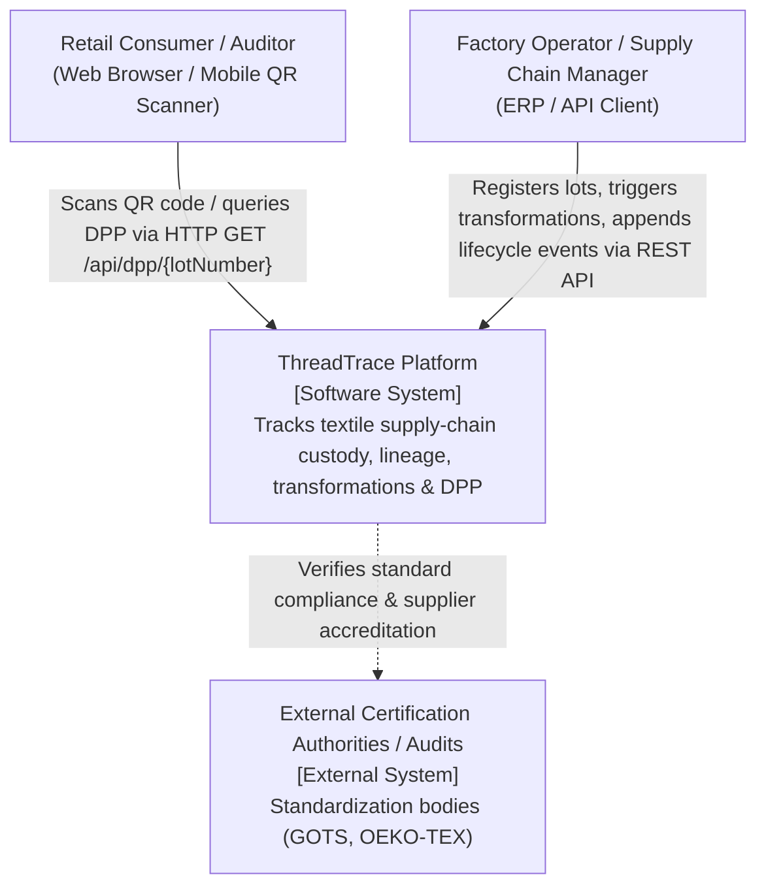
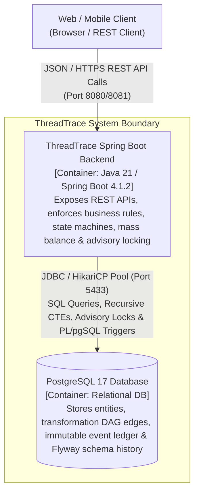
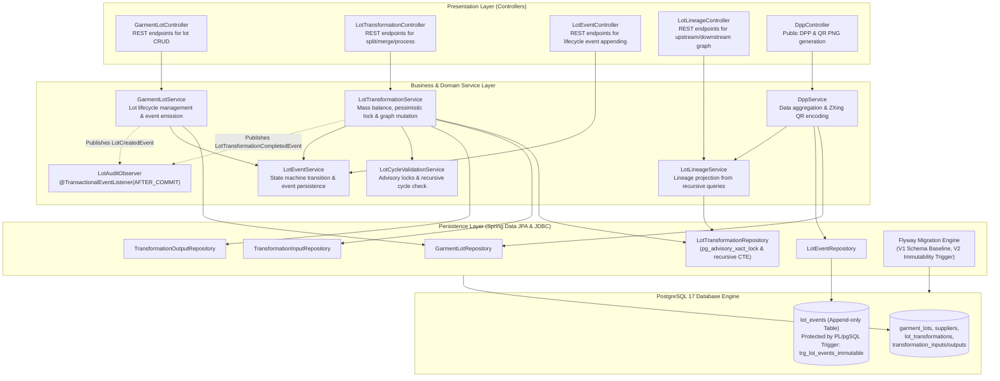

# ThreadTrace Architecture Documentation

## 1. System Overview
ThreadTrace is an enterprise-grade traceability and provenance platform tailored for the textile and garment manufacturing supply chain. It addresses stringent global regulatory mandates (such as the EU Corporate Sustainability Due Diligence Directive and Digital Product Passport frameworks) by providing verifiable custody tracking, append-only event auditing, transformation lineage modeling (Directed Acyclic Graphs), and automated cycle detection.

---

## 2. C4 Architecture Models

### 2.1 C4 Level 1: System Context Diagram
The System Context diagram illustrates how external actors (supply chain managers, factory operators, compliance auditors, and retail consumers) interact with ThreadTrace and external ecosystem services.

### 2.2 C4 Level 2: Container Diagram
The Container diagram highlights the high-level technical building blocks, boundaries, and data storage systems.

### 2.3 C4 Level 3: Component Diagram (Backend API Application)
The Component diagram provides a detailed view of the Spring Boot application's internal structure and layered architecture.

---

## 3. Core Architectural Modules

### 3.1 Append-Only Event Ledger & Database Immutability
- Every critical state change emits a `LotEvent` record capturing `garment_lot_id`, `event_type`, `previous_status`, `new_status`, `performed_by`, `description`, `occurred_at`, and `recorded_at`.
- At the database level, PostgreSQL trigger `trg_lot_events_immutable` executes `prevent_lot_event_modification()`, unconditionally rejecting any `UPDATE` or `DELETE` with SQLSTATE `23514` / `integrity_constraint_violation`.

### 3.2 Transformation Lineage & Directed Acyclic Graph (DAG)
- Transformations represent multi-input, multi-output supply chain steps (`SPLIT`, `MERGE`, `PROCESS`).
- Upstream and downstream lineage are projected via PostgreSQL Recursive Common Table Expressions (CTEs), traversing `transformation_inputs` and `transformation_outputs`.
- Cycle prevention is enforced via two complementary defenses:
  1. Transactional Advisory Locking: `pg_advisory_xact_lock(4287941209871625412L)` serializes lineage graph mutations without lock escalation or deadlocks.
  2. Recursive Path Checking: `LotCycleValidationService` evaluates whether any input lot is already reachable downstream from proposed output lots.

### 3.3 Digital Product Passport (DPP) & Privacy Separation
- Public endpoint `GET /api/dpp/{lotNumber}` exposes high-level lot information, public supplier profile (`name`, `country`, `address`), event history, upstream provenance lots, and transformation history.
- Sensitive supplier contact information (`email`, `phone`) and internal factory notes are excluded from public DTOs.
- Public endpoint `GET /api/dpp/{lotNumber}/qr` generates dynamic 300x300 PNG QR codes encoding the canonical passport URL.
