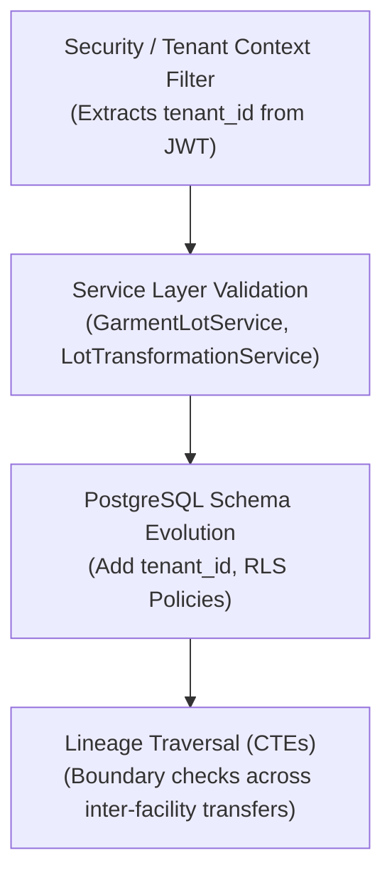

# Software Change Request & Impact Analysis: Multi-Tenant Factory Isolation

## 1. Change Request Overview
- **CR Identifier:** `CR-2026-004`
- **Title:** Introduce Multi-Tenant Factory Partitioning for Garment Lots and Event Audits
- **Requested By:** Global Supply Chain Compliance Directorate
- **Priority:** High
- **Target Release:** ThreadTrace v2.0

### Business Objective
Currently, ThreadTrace operates on a shared database schema where lots from multiple garment manufacturing facilities reside in common tables. To support multi-facility enterprise deployments and meet international data residency and tenant isolation standards, the system must enforce strict tenant segregation so that factory operators can only view and mutate lots originating from their authorized factory tenant.

---

## 2. Impact Analysis



### 2.1 Affected Architectural Modules
1. **Database Schema & Migrations:**
   - Tables `garment_lots`, `suppliers`, `lot_transformations`, and `lot_events` require an added `tenant_id VARCHAR(50) NOT NULL` column.
   - Composite indexes on `(tenant_id, lot_number)` and `(tenant_id, garment_lot_id)`.
   - PostgreSQL Row-Level Security (RLS) policies to isolate tenant queries at the database kernel level.
2. **Domain Entities & JPA:**
   - Add `@Column(name = "tenant_id", nullable = false, updatable = false)` across `GarmentLot`, `Supplier`, `LotEvent`, and `LotTransformation`.
   - Update Spring Data JPA query methods to filter by `tenant_id`.
3. **Lineage Traversal Engine:**
   - When a garment lot is shipped from Facility A (Tenant A) to Facility B (Tenant B), the lineage CTE must support authorized multi-tenant federation while masking internal non-shared operational events.

---

## 3. Implementation Plan & Migration Strategy

### Step 1: Database Migration (`V3__add_tenant_isolation.sql`)
```sql
ALTER TABLE garment_lots ADD COLUMN tenant_id VARCHAR(50) NOT NULL DEFAULT 'DEFAULT_TENANT';
ALTER TABLE suppliers ADD COLUMN tenant_id VARCHAR(50) NOT NULL DEFAULT 'DEFAULT_TENANT';
ALTER TABLE lot_events ADD COLUMN tenant_id VARCHAR(50) NOT NULL DEFAULT 'DEFAULT_TENANT';
ALTER TABLE lot_transformations ADD COLUMN tenant_id VARCHAR(50) NOT NULL DEFAULT 'DEFAULT_TENANT';

CREATE INDEX idx_garment_lots_tenant ON garment_lots (tenant_id, lot_number);
```

### Step 2: Tenant Context Interceptor
Create a Spring `HandlerInterceptor` that extracts the `X-Tenant-ID` header (or JWT claim) and binds it to a `ThreadLocal` `TenantContext`.

### Step 3: Service Layer Enforcement
Update `GarmentLotService.createLot()` to stamp the current tenant from `TenantContext.getTenantId()`. Update `LotTransformationService` to verify that all input lots belong to the current tenant or have an authorized inter-tenant handoff event.

---

## 4. Verification & Testing Strategy
1. **Tenant Segregation Test:** Create Lot 1 under Tenant A. Query lots using Tenant B context; assert `404 Not Found` or empty page.
2. **Cross-Tenant Transformation Protection:** Attempt a merge transformation with Lot A (Tenant A) and Lot B (Tenant B) without cross-tenant delegation; assert `403 Forbidden` or `409 Conflict`.
3. **Regression Safety:** Execute full 60-test regression suite ensuring single-tenant backward compatibility remains 100% operational.
